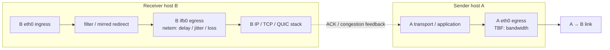

# Linux `tc` Weak-Network and High-Delay Emulation Guide

*Transport protocols, congestion control, and BBR perspective*

[简体中文](./tc-configuration-guide.md)

> **Scope and references**
> This guide is intended for performance testing of transport protocols (TCP, QUIC, BATS, KCP, etc.) and congestion-control algorithms such as BBR and CUBIC. It is based on [tc-strategy.md](./tc-strategy.md), the [advanced `tc` guide](./tc-advanced-network-impairments.md), and the Linux [`tc-netem(8)` manual](https://www.man7.org/linux/man-pages/man8/tc-netem.8.html). It focuses on four practical topics: **loss models and Markov parameters; delay distributions and jitter; the best A→B placement for bandwidth, latency, and loss; and queue sizing under high bandwidth-delay products (BDP) to prevent overflow**.

---

## 1. Loss-model selection and a classic 4-state Markov weak-network profile

For real Internet and wireless-edge paths, protocol performance depends not only on the average loss rate but also on the **temporal correlation of loss**—in particular, whether losses occur in bursts. `tc-netem` provides three loss models:

### 1.1 Loss-model comparison and transport-layer impact

| Model syntax | Statistical characteristics | Impact on TCP / QUIC / FEC and BBR | Suitable tests |
| --- | --- | --- | --- |
| `loss random PERCENT` (or the shorthand `loss PERCENT`) | **Independent Bernoulli loss**: each packet is sampled independently, with no memory; inter-loss gaps follow a geometric distribution, so losses are usually isolated single packets. For example, with 2% loss, the probability of two consecutive losses is only 0.04%. *Note: the optional `CORRELATION` argument for `loss random` is discouraged in the documentation because of its poor statistical behavior.* | - **CUBIC / Reno:** The Mathis relationship, `BW ∝ MSS / (RTT × √p)`, predicts frequent window reductions under random loss. Since losses are usually isolated, SACK/RACK can often recover within one RTT, and RTOs are uncommon.<br>- **FEC protocols (e.g. BATS/QUIC-FEC):** An encoding block may lose only one packet, which lightweight redundancy can easily mask, **overestimating weak-network decoding performance**.<br>- **BBR:** BBRv1 mostly ignores isolated random loss. Although BBRv2/v3 introduce a per-round loss threshold around `2%` (`loss_thresh`), uniformly scattered single-packet losses are less likely to create a high local loss rate in one RTT round and therefore exert less pressure on `inflight_hi`. | Baseline noise tolerance and throughput under non-congestion random errors, such as comparing BBR and CUBIC loss sensitivity. |
| `loss state p13 [p31 [p32 [p23 [p14]]]]` | **4-state Markov chain (GI model):** Explicitly separates a normal gap period from a degraded burst period. It can independently control burst length, occasional good packets within a burst, and background isolated losses. | - **Realistic weak-network behavior:** Consecutive losses can exceed FEC redundancy, exhaust SACK recovery, and cause tail losses that trigger TLP or RTO timeout.<br>- **BBRv2/v3 stress:** A burst can create a local loss rate well above `2%` within one RTT, exercising short-term `inflight_hi` reduction, early Startup exit, ProbeBW gain suppression, and delivery-rate sampling across sequence gaps. | **Preferred for realistic weak-network tests** over WAN, Wi-Fi, or cellular links. |
| `loss gemodel p [r [1-h [1-k]]]` | **Two-state Gilbert–Elliott model:** Switches between Good and Bad states; packet loss is independently sampled within each state using `1-k` and `1-h`, respectively. *The third and fourth CLI arguments are loss probabilities `1-h` and `1-k`, not success probabilities.* | Models transitions between good and bad channel periods, but does not separate normal-period isolated loss from good-packet gaps within a burst as directly as the 4-state GI model. | Emulating a two-state wireless channel when fitted parameters (`p`, `r`, `1-h`, `1-k`) are already available. |

### 1.2 4-state Markov mechanics and steady-state metrics

The kernel's `sch_netem` implementation (`loss_4state`) maintains four states. For each arriving packet it applies a state transition probability and then decides whether that packet is transmitted or dropped:

- **State 1 (normal good-packet state):** The packet is delivered. The model enters burst-loss State 3 with probability `p13`, isolated-loss State 4 with probability `p14`, or stays in State 1 with probability `1 - p13 - p14`.
- **State 2 (good-packet gap within a burst):** The packet is delivered. The model returns to burst-loss State 3 with probability `p23`, or stays in State 2 with probability `1 - p23`.
- **State 3 (burst-loss state):** **The current packet is dropped.** The model recovers to normal State 1 with probability `p31`, moves to the good-packet gap State 2 with probability `p32`, or continues consecutive loss with probability `1 - p31 - p32`.
- **State 4 (isolated-loss state):** **The current packet is dropped.** The next packet returns unconditionally to State 1, so State 4 represents exactly one isolated loss rather than a run.

> **Syntax warning:** If only `loss state p13` is supplied, iproute2 defaults to `p31 = 1 - p13`, `p32 = 0`, `p23 = 100%`, and `p14 = 0`. This **reduces to ordinary Bernoulli random loss** and does not create bursts. Specify parameters such as `p31` explicitly to produce burst loss.

Define the normalization factor:

$$Z = 1 + p_{14} + \frac{p_{13}}{p_{31}}\left(1 + \frac{p_{32}}{p_{23}}\right)$$

The steady-state loss rate and related metrics are:

$$P_{\text{loss}} = \pi_3 + \pi_4 = \frac{\frac{p_{13}}{p_{31}} + p_{14}}{Z}, \qquad L_{\text{consec}} = \frac{1}{p_{31} + p_{32}}, \qquad N_{\text{burst\_drops}} = \frac{1}{p_{31}}$$

Here, `P_loss` is the long-run total loss rate, `L_consec` is the mean number of consecutive losses in one State 3 run, and `N_burst_drops` is the mean number of dropped packets in a complete burst event.

### 1.3 Recommended classic weak-network parameters

For transport and BBR tests over weak WAN or wireless-edge paths, the following **classic baseline profile** is recommended. Its steady-state total loss rate is approximately `2.4%`, comprising about 80% burst loss and 20% background isolated loss:

```bash
# Classic weak-network profile:
# total loss ≈ 2.42% = burst loss ≈ 1.94% + isolated background loss ≈ 0.48%
loss state 0.6% 30% 20% 50% 0.5%
```

**Why use this profile:**

1. **Exercises congestion-control loss sensitivity:** The long-run loss rate of about `2.42%` is near the `2%` loss-sensitive region commonly associated with BBRv2/v3, and can expose differences among BBR, CUBIC, and protocols with FEC/ARQ optimizations without making the path so impaired (`>10%`) that steady-state congestion control is obscured.
2. **Models both consecutive loss and good-packet gaps:** With `p31 = 30%`, `p32 = 20%`, and `p23 = 50%`, the mean consecutive-loss run is `L_consec = 2.0` packets (often 2–5 packets in practice). A complete burst event spans an average of `4.67` packets and drops `3.33` of them, for a `71.4%` loss density during the burst period. This approximates Wi-Fi retransmission backoff, cellular handover, and microburst tail loss.
3. **Retains background noise:** `p14 = 0.5%` adds isolated single-packet losses during otherwise stable periods, so the good state is not unrealistically perfect.

The following three profiles scale the impairment level:

| Profile | `loss state p13 p31 p32 p23 p14` | Steady-state total loss | Burst / isolated contribution | Mean drops per burst | Example environment |
| --- | --- | --- | --- | --- | --- |
| **Mild weak network** | `loss state 0.5% 35% 15% 60% 0.1%` | `≈ 1.50%` | `1.40%` / `0.10%` | `2.86` packets | Metro wireless backhaul, lightly loaded inter-provider path |
| **Classic weak network (recommended default)** | `loss state 0.6% 30% 20% 50% 0.5%` | `≈ 2.42%` | `1.94%` / `0.48%` | `3.33` packets | Public Wi-Fi, weak 4G/5G, shared transoceanic path |
| **Severe weak network (stress test)** | `loss state 1.5% 30% 20% 50% 0.5%` | `≈ 5.12%` | `4.65%` / `0.47%` | `3.33` packets | Weak cellular coverage, highly contended burst-loss path |

---

## 2. Delay-distribution selection and jitter configuration

### 2.1 Delay-distribution comparison

In `tc-netem`, `delay TIME [JITTER [CORRELATION]] [distribution TYPE]` uses `TIME` as the base delay (`μ`) and `JITTER` as the variation scale (`σ`) when sampling each packet's delay offset. The distribution characteristics below are based on the Linux `sch_netem.c` implementation and iproute2 distribution tables (`/usr/lib/.../tc/*.dist`):

| Distribution | `tc` example | Sampling range and tail (relative to `JITTER` `σ`) | Transport / congestion-control perspective |
| --- | --- | --- | --- |
| **Fixed delay** | `delay 50ms` (omit `JITTER`) | Constant `μ`; no jitter or jitter-induced reordering. | Ideal propagation-delay (`RTprop`) baseline for measuring BDP, window growth, and theoretical throughput. |
| **Uniform** | `delay 50ms 10ms [25%]` (**omit `distribution`**) | Flat, equally weighted interval `[μ − 1.0σ, μ + 1.0σ]`; bounded, with no long tail. | Mechanically simple: it has neither a central concentration nor tail spikes. Useful mainly for basic bounded-range tests. |
| **Normal** | `delay 50ms 10ms [25%] distribution normal` | Approximately `−4.0σ` to `+3.52σ`, bell-shaped (`P95 ≈ +1.65σ`, `P99 ≈ +2.33σ`). | Models small random queueing variations on stable wired paths or multi-hop backbones, but its tail decays quickly and may not reproduce weak-link spikes. Oasis currently uses this when `jitter > 0`. |
| **Pareto** | `delay 50ms 10ms [25%] distribution pareto` | Approximately `−0.67σ` to `+4.0σ`, strongly skewed with a heavy positive tail (median `−0.32σ`; `P99` reaches `+4.0σ`). | Most packets stay near the low-delay baseline while rare packets experience large spikes. Useful for testing TCP/QUIC RTO robustness and real-time P99/P999 tail latency. |
| **Paretonormal** | `delay 50ms 10ms [25%] distribution paretonormal` | Approximately `−1.50σ` to `+3.88σ`, combining a Gaussian-like body with a heavier tail above `+3.58σ`. | **Recommended starting point for realistic weak-network tests:** combines everyday small queueing jitter with occasional long-tail spikes. Calibrate to the target path. |

> **Important: `uniform` CLI errors and default-distribution differences**
>
> 1. Although the `tc-netem(8)` syntax lists `distribution uniform`, standard iproute2 installations commonly ship `normal.dist`, `pareto.dist`, `paretonormal.dist`, and `experimental.dist`, but **not `uniform.dist`**. Explicitly running `distribution uniform` can fail with `No distribution data for uniform`. To use the kernel's uniform fallback, write `delay TIME JITTER` without a `distribution` argument; when no distribution table is loaded, `tabledist()` falls back to uniform sampling.
> 2. Some distribution-specific man pages say Normal is the default when `distribution` is omitted, which conflicts with the kernel's no-table Uniform fallback. For production tests, explicitly specify `distribution normal` or `distribution paretonormal` whenever a non-uniform profile is required; do not rely on an implicit default.

### 2.2 Pairing jitter correctly (BBR and TCP pitfalls)

Configuring `delay TIME JITTER` without considering transport filters and kernel queueing can distort the emulation.

1. **Bound `JITTER / TIME` to avoid contaminating BBR's `RTprop` (minimum-RTT filter).**
   - **Mechanism:** BBR tracks the path's minimum round-trip propagation time using a 10-second minimum filter, `RTprop = min(RTT)`, and uses it to calculate the target congestion window: `cwnd = cwnd_gain × BtlBw × RTprop`.
   - **Risk:** The Normal distribution table extends down to **`−4.0σ`**. With one-way `delay 40ms 15ms distribution normal` (mean RTT `80ms` when both directions are symmetric), a `−3σ` sample can make the one-way delay approach zero or go negative. If an unusually small sample enters BBR's 10-second `min_rtt` window, it can keep `RTprop` far below the intended baseline, understate BDP, constrain `cwnd`, and prevent the flow from filling the link even with no packet loss.
   - **Guidance:**
     - With `normal`, keep **`JITTER ≤ TIME / 4`**; for steady scenarios, use `JITTER = 10%–20% × TIME`.
     - For large positive delay spikes, prefer **`pareto`** (lower bound near `−0.67σ`, positive tail up to `+4.0σ`) or **`paretonormal`** (lower bound near `−1.50σ`). These permit positive spikes without driving the configured delay below the physical minimum.

2. **Use `CORRELATION` (recommended `25%–50%`) to reduce unrealistic jitter-induced reordering.**
   - **Mechanism:** `sch_netem` uses a red-black-tree time FIFO (`tfifo`) ordered by each packet's scheduled `time_to_send = now + delay`. At `100 Mbps`, the serialization interval for a `1500B` packet is only **`0.12 ms`**. If a later packet is assigned a delay more than `0.12 ms` shorter than its predecessor, it can overtake that packet in the queue and be released first. *(On modern Linux, `tfifo` performs time-based ordering before packets are handed to a child qdisc; the older manual suggestion to attach a child `pfifo` does not undo that ordering.)*
   - **Risk:** With completely independent samples (`CORRELATION = 0%`), millisecond-scale jitter can cause frequent reordering. Traditional TCP may mistake it for loss after three duplicate ACKs, or increase its RACK reordering window and delay recovery. It can also affect BBR's ACK aggregation (`extra_acked`) and delivery-rate sampling.
   - **Guidance:** Queueing delay in real networks is temporally correlated because adjacent packets often experience similar backlog. **When configuring `JITTER`, consider adding `25%–50%` correlation** to smooth adjacent samples:

     ```bash
     # Example: 40 ms one-way base delay, 6 ms jitter, 30% correlation, mixed long tail
     delay 40ms 6ms 30% distribution paretonormal
     ```

---

## 3. Best `bw` / `latency` / `loss` placement for A→B traffic

For a one-way A→B flow (Host A sends data; Host B receives it and returns ACKs), do not combine all three controls on one interface. Follow the separation principle: **shape bandwidth at the sender's egress; redirect receiver ingress to IFB to add delay and loss.** This is also the current Oasis architecture in `ContainerizedNetwork`.

### 3.1 Topology and recommended placement



*Figure 3.1. In the A→B direction, place `bw` at A's `eth0` egress and `latency`/`loss` at B's `eth0 ingress → ifb0` path.*

- **Best point for `bw` (bottleneck bandwidth):** the sender A's network-device egress (`A: eth0 egress`, using `tbf` or `htb`). *(If the topology has a dedicated intermediate bottleneck router `R`, shape at the forwarding egress of `R`; in a direct two-host A—B model, this corresponds to A's `eth0 egress`.)*
- **Best point for `latency` (propagation delay and jitter):** receiver B's ingress redirected to the `ifb0` egress (`B: eth0 ingress → mirred redirect → ifb0 root netem delay`).
- **Best point for `loss` (non-congestion channel loss):** receiver B's `ifb0` egress (`B: ifb0 root netem loss`), alongside `delay`.
- *For symmetric or asymmetric bidirectional weak-network tests, mirror the configuration for B→A: limit reverse bandwidth at `B: eth0 egress`, and apply reverse `latency/loss` at `A: eth0 ingress → ifb0`. The per-direction delays together contribute to end-to-end RTT.*

### 3.2 Why are these the preferred points? Three perspectives

1. **Reference and Linux networking stack: avoid sender-side TSQ interference and `skb->cb` conflicts.**
   - [`tc-netem(8)`](https://www.man7.org/linux/man-pages/man8/tc-netem.8.html) explicitly states in **LIMITATIONS**: *“Due to mechanisms like TSQ (TCP Small Queues), for TCP performance test results to be realistic netem must be placed on the ingress of the receiver host.”*
   - Linux sender-side **TSQ (`tcp_limit_output_bytes`)** limits the amount of data from a TCP socket retained in local qdiscs and NIC transmit rings. This reduces local queueing delay and cooperates with `fq` / EDT (Earliest Departure Time) pacing. Placing high-delay `netem` directly at A's egress can interfere with sender-side TSQ backpressure and BBR pacing. The `tc-netem(8)` manual also notes that `netem` uses `skb->cb` for timestamps, which can create compatibility issues when layered with complex qdiscs at the same egress. Applying `netem` at B's `ingress → ifb0` keeps A's protocol stack and TBF path cleaner.

2. **Queueing theory: preserve the physical order of serialization, propagation, and channel loss.**
   - A simplified physical sequence is: **the bottleneck serializes packets at rate `μ = BW` (spacing packets by `Δt = L/BW`; excess bursts queue and wait `Wq`) → packets experience propagation delay `D_prop` and channel loss `p` → packets reach the receiver.**
   - **Why put `bw` at A egress:** upstream shaping injects packets at the target bottleneck rate and creates the intended sender-side bottleneck queue.
   - **Why put `loss` downstream of `bw` (at B ingress):** if random loss is placed before the TBF limiter, dropped packets consume no tokens, so the modeled bottleneck effectively carries fewer packets and its delivered payload rate can be inflated by approximately `1/(1-p)`. Loss at B ingress means packets have already consumed the upstream A egress capacity and acquired the intended packet spacing before being lost or delayed downstream.

3. **Congestion control and BBR: preserve bottleneck-rate samples and the ACK feedback loop.**
   - **BBR estimates bottleneck bandwidth from delivered data over time:** `BtlBw = max(Δdelivered / Δt)`. TBF at `A: eth0 egress` controls the packet serialization rate leaving the configured bottleneck. `B: ifb0 netem` then adds propagation delay and channel loss before packets enter B's IP/TCP/QUIC stack and generate ACK/SACK.
   - This order lets B observe the impaired packet arrival sequence and timing, while A receives ACKs, SACK blocks, and duplicate ACKs after the configured path delay. It avoids turning the impairment into an immediate sender-local drop signal and helps preserve BBR delivery-rate and `RTprop` measurements.

### 3.3 Standard A→B command example

```bash
# 1) On sender A: limit bandwidth at eth0 egress.
# Example: 100 Mbit/s, with a 50 ms TBF queueing-time ceiling.
tc qdisc replace dev eth0 root handle 1: tbf rate 100mbit burst 128kb latency 50ms

# 2) On receiver B: create ifb0 and redirect IP ingress traffic from eth0.
# Run the ip link add command only if ifb0 does not already exist.
ip link add name ifb0 type ifb
ip link set dev ifb0 up
tc qdisc replace dev eth0 ingress
tc filter add dev eth0 parent ffff: protocol ip u32 match u32 0 0 action mirred egress redirect dev ifb0

# 3) On receiver B: apply delay, jitter, 4-state loss, and a queue limit on ifb0.
tc qdisc replace dev ifb0 root netem \
  limit 3000 \
  delay 50ms 6ms 30% distribution paretonormal \
  loss state 0.6% 30% 20% 50% 0.5%
```

---

## 4. Queue limits under bandwidth-delay configuration

One subtle failure in high-bandwidth or high-delay (Long Fat Network, LFN) emulation is this: **a test configured for `loss 0%` and delay alone suffers a throughput collapse and retransmissions because `netem limit` is too small to hold packets in the delay pipe. The intended delay simulation then becomes queue-overflow tail loss.**

### 4.1 Distinguish two queues with different units

In the `TBF (A egress) + NetEm (B ifb0)` design, two queues have different physical roles and **different units**:

| Queue setting | Role | **Exact unit** | Default / consequence when too small |
| --- | --- | --- | --- |
| **`netem limit COUNT`** | **Delay-pipe capacity (wire-in-flight pipe):** holds packets that are waiting for their scheduled release. | **Packet count (packets / skbs), not bytes.** | The iproute2 default is only **1000 packets**. Once the queue exceeds the limit, `netem_enqueue` can return `NET_XMIT_DROP`, contaminating a delay-only test. |
| **`tbf latency TIME` (or `limit BYTES`) plus `burst BYTES`** | **Bottleneck buffer:** holds packets that arrive faster than the bottleneck rate while they wait for tokens. | `latency` is time; `limit` and `burst` are **bytes**. | A hard-coded `latency 1ms` can be a very shallow buffer (about 1% of BDP at a 100 ms RTT). CUBIC slow start or BBR ProbeBW's `1.25×` probing gain may then encounter tail drops at sender-side TBF. |

> **Oasis implementation note:** In `src/containernet/containernet_network.py`, `current_bdp = int(1.25 * delay * bw * 1000 / 8)` computes a value in **bytes**, then inserts it directly into `netem ... limit {current_bdp}`, which the kernel interprets as a **packet count**. This unit mismatch makes the allowed packet count about 1500 times larger than the corresponding byte count for 1500-byte packets, avoiding many `netem` overflows but allowing an excessively large queue. The code also uses `tbf ... latency 1ms`, which can be a very shallow bottleneck buffer for high-delay tests; take care when evaluating high-BDP throughput.

### 4.2 Calculate `netem limit` to avoid overflow

By Little's law (`L = λW`), when packets enter receiver-side `ifb0 netem` at a rate limited to bandwidth `B` in Mbps, the maximum number of packets resident in the pipe depends on the **effective maximum one-way residence delay `D_eff` in ms** and the upstream burst size `B_burst`:

1. **Include the jitter tail when choosing `D_eff`:**
   - No jitter (`J = 0`): `D_eff = D_base`.
   - Uniform jitter: `D_eff = D_base + J`.
   - Normal / Pareto long-tail distributions (tables with an upper bound near `+4σ`): `D_eff = D_base + 4J`.

2. **Calculate one-way in-flight bytes and convert to a packet-count limit:**

$$\text{BDP}_{\text{1-way, bytes}} = \frac{B_{\text{Mbps}} \times 10^6 \times (D_{\text{eff, ms}} / 1000)}{8} = 125 \times B_{\text{Mbps}} \times D_{\text{eff, ms}}$$

$$\text{limit}_{\text{netem}} \text{ (Packets)} = \max\!\left(2000,\; \left\lceil \alpha \times \frac{125 \times B_{\text{Mbps}} \times D_{\text{eff, ms}} + B_{\text{burst}}}{S_{\text{pkt}}} \right\rceil \right)$$

**Parameter guidance:**

- **`S_pkt` (average packet size, bytes):**
  - For large-packet throughput tests (iperf3 / file transfer), use `1500` (this may underestimate packet count if GSO is disabled or traffic contains many small packets).
  - For mixed traffic, QUIC control packets, games, audio/video, or reverse-path TCP ACKs (roughly `64–100B`), remember that **`netem` counts packets, not bytes**. At the same bandwidth, `500B` packets have three times the packet rate of `1500B` packets. Use a conservative `S_pkt` such as **`500`**; for a pure reverse ACK path, estimate using the ACK packet rate under forward data load.
- **`α` (safety factor):**
  - **Standard setup with upstream TBF:** traffic entering `netem` is capped at `B_Mbps`. Use **`α = 1.5–2.0`** to absorb token-bucket bursts and kernel timer batching.
  - **No upstream rate limit, or `netem` placed before the limiter:** TCP slow start or BBR Startup (`cwnd_gain = 2`, `pacing_gain ≈ 2.77–2.89`) can inject a full window at virtual-NIC line rate. In this case, replace `D_eff` with the **full-path `RTT_max`** and use **`α = 2.5–3.0`**.
- **Do not blindly use an enormous constant such as `limit 20000000`:** although it is not immediately preallocated, it can permit very large skb backlogs under an unexpectedly high input rate, consume kernel memory, and create seconds of uncontrolled queueing. Calculate the limit and use finite headroom.

### 4.3 Suggested limits for common bandwidth-delay profiles

The table below assumes the standard `A egress TBF + B ifb0 NetEm` arrangement, a `2.0` safety factor, and headroom for 1500-byte packets plus ordinary mixed traffic. It also suggests a corresponding TBF configuration:

| Scenario | Bandwidth `B` | One-way delay `D` (symmetric RTT) | Jitter `J` (Paretonormal) | Would default `limit 1000` overflow? | Suggested `netem limit` (packets) | Suggested A egress TBF (avoid shallow-buffer loss) |
| --- | --- | --- | --- | --- | --- | --- |
| 4G / weak mobile edge | `20 Mbps` | `40 ms` (RTT `80 ms`) | `8 ms` (`D_eff = 72 ms`) | No (but small-packet flows approach the limit) | **`2000`** (floor) | `rate 20mbit burst 32kb latency 50ms` |
| Inter-province WAN | `100 Mbps` | `50 ms` (RTT `100 ms`) | `5 ms` (`D_eff = 70 ms`) | Large packets are near the limit; small packets overflow | **`2000–3000`** | `rate 100mbit burst 128kb latency 50ms` |
| Transoceanic Long Fat Network (LFN) | `200 Mbps` | `100 ms` (RTT `200 ms`) | `10 ms` (`D_eff = 140 ms`) | **Severe overflow** (more than 2333 packets for 1500B packets) | **`5000–8000`** | `rate 200mbit burst 256kb latency 100ms` |
| High-speed inter-region data-center link | `1000 Mbps` | `50 ms` (RTT `100 ms`) | `2 ms` (`D_eff = 58 ms`) | **Severe overflow** (more than 4833 packets for 1500B packets) | **`10000–20000`** | `rate 1000mbit burst 1250kb latency 50ms` |
| Ultra-high-bandwidth transoceanic circuit | `4000 Mbps` | `100 ms` (RTT `200 ms`) | `5 ms` (`D_eff = 120 ms`) | **Catastrophic overflow** (more than 40000 packets) | **`80000–120000`** | `rate 4000mbit burst 5000kb latency 100ms` |

> **Additional TBF guidance for BBR/TCP**
>
> - **`tbf burst`:** Keep `burst ≥ max(10 × MTU, rate / HZ)`. The amount sent at line rate in `1 ms` is `rate_Mbps × 125 bytes` (e.g. `125 KB` at `1000 Mbps`). With TSO/GSO aggregates (which can reach `64 KB`) and timer jitter, consider a burst equivalent to `5–10 ms` of traffic at high rates—for example, `128kb` at `100 Mbps` and `1250kb` at `1000 Mbps`. A bucket that is too small can prevent the configured rate from being reached.
> - **`tbf latency`:** Unless testing a shallow-buffer microburst switch, consider `0.5 × RTT` to `1.0 × RTT` (e.g. `50–100 ms` at `100 ms` RTT). This is intended to hold the queue through BBR ProbeBW's `1.25×` probing gain and single-flow CUBIC window variations.

### 4.4 Verify that no unintended queue overflow occurred

After each load test, inspect qdisc statistics on both A and B:

```bash
# On receiver B: inspect the netem queue.
# For a delay-only test (loss 0%), dropped should be zero.
# Any unexpected drops may indicate an undersized limit.
tc -s qdisc show dev ifb0

# On sender A: inspect the TBF bottleneck queue.
# Check whether backlog and drops match the intended bottleneck behavior,
# rather than early drops caused by an undersized burst/latency setting.
tc -s qdisc show dev eth0
```
