# Linux `tc` 弱网与高时延仿真配置指南（传输协议与 BBR 视角）

[English version](./tc-configuration-guide.en.md)

> **适用范围与参考基线**  
> 本指南面向传输协议研发（TCP / QUIC / BATS / KCP 等）与拥塞控制算法（BBR、CUBIC）性能评测，基于 [tc-strategy.md](./tc-strategy.md)、Linux 官方手册 [`tc-netem(8)`](https://www.man7.org/linux/man-pages/man8/tc-netem.8.html) 提炼而成，聚焦四个核心工程问题：**丢包分布与马尔可夫参数、时延分布与 Jitter 协同、`A → B` 最佳配置点位、高带宽时延积（BDP）下的队列 `limit` 防溢出计算**。

---

## 1. 丢包分布选型与 4-State Markov 经典弱网配置

在真实互联网与无线边缘网络中，协议性能不仅取决于“平均丢包率”，更取决于**丢包的时间相关性（是否成串突发丢失）**。`tc-netem` 提供三类丢包模型：

### 1.1 三类丢包模型对比与传输层影响

| 模型语法                                     | 统计特征                                                                                                                                                                                                                   | 对 TCP / QUIC / FEC 与 BBR 的影响                                                                                                                                                                                                                                                                                                                                                                                                                                                                          | 适用测试场景                                                                         |
| -------------------------------------------- | -------------------------------------------------------------------------------------------------------------------------------------------------------------------------------------------------------------------------- | ---------------------------------------------------------------------------------------------------------------------------------------------------------------------------------------------------------------------------------------------------------------------------------------------------------------------------------------------------------------------------------------------------------------------------------------------------------------------------------------------------------- | ------------------------------------------------------------------------------------ |
| `loss random PERCENT`（简写 `loss PERCENT`） | **Bernoulli 独立随机丢包**：每包独立抽样，无记忆性；丢包间隔服从几何分布，几乎全为孤立单包丢失（如 `2%` 丢包下连丢 2 包概率仅 `0.04%`）。*注：`loss random` 的可选 `CORRELATION` 参数因统计特性不佳已在文档中标记不推荐。* | - **CUBIC / Reno**：受 Mathis 公式 $\text{BW} \propto \frac{\text{MSS}}{\text{RTT}\sqrt{p}}$ 制约，随机丢包即会导致频繁降窗，但因几乎全是单包丢失，SACK/RACK 极易在 1 RTT 内恢复，很少触发 RTO。<br>- **FEC 协议（如 BATS/QUIC-FEC）**：每个编码块通常只丢 1 包，极易被轻量冗余完全掩盖，**严重高估弱网解码率**。<br>- **BBR**：BBRv1 基本忽略孤立随机丢包；BBRv2/v3 虽引入约 `2%` 单轮丢包率阈值（`loss_thresh`），但均匀离散的单包丢失很难在单个 RTT 轮次内形成局部高密突破，对 `inflight_hi` 压制较轻。 | 基础抗噪能力基线、验证非拥塞随机误码下的吞吐曲线（如 BBR vs CUBIC 抗随机丢包拐点）。 |
| `loss state p13 [p31 [p32 [p23 [p14]]]]`     | **4-State Markov Chain（GI 模型）**：显式区分**正常期（Gap Period）**与**突发恶化期（Burst Period）**，可同时独立控制“成串突发丢包长度”、“突发期内偶发好包”与“背景孤立单包丢失”。                                          | - **真实还原弱网痛点**：连续丢包会直接打穿 FEC 冗余上限、耗尽 SACK 恢复能力并诱发尾包丢失（触发 TLP 乃至 RTO 超时）。<br>- **精准检验 BBRv2/v3**：突发期在 1 个 RTT 内制造远超 `2%` 的局部丢包率，直接触发 BBR 短期模型下调 `inflight_hi`、提前退出 `Startup` 或抑制 `ProbeBW` 增益，同时检验交付速率采样（`delivery_rate`）在序列空洞下的鲁棒性。                                                                                                                                                         | **真实弱网/跨国链路/Wi-Fi 与蜂窝移动网络评测首选**。                                 |
| `loss gemodel p [r [1-h [1-k]]]`             | **Gilbert–Elliott 两状态模型**：在 Good / Bad 两状态间切换，状态内分别按固定概率 `1-k`、`1-h` 独立丢包。*注意 CLI 第 3、4 个参数填的是丢包率 `1-h` 和 `1-k`，而非好包率。*                                                 | 能表达好/坏信道切换，但无法像 4-State GI 模型那样直观拆解“正常期孤立单包丢失”与“突发期内间隙好包”。                                                                                                                                                                                                                                                                                                                                                                                                        | 已有现成两态无线信道拟合参数（`p, r, 1-h, 1-k`）时的等效仿真。                       |

### 1.2 4-State Markov 模型机理与稳态指标核算

内核 `sch_netem`（`loss_4state`）维护 4 个状态，每到达一个数据包先按转移概率切换状态，再决定该包收发：

- **State 1（正常好包态）**：分组正常通过；以 `p13` 进入突发丢包态（State 3），以 `p14` 进入孤立丢包态（State 4），以 `1 - p13 - p14` 保持正常。
- **State 2（突发期内的间隙好包态）**：分组正常通过；以 `p23` 重新回到突发丢包态（State 3），以 `1 - p23` 留在 State 2。
- **State 3（突发丢包态）**：**当前分组丢弃**；以 `p31` 恢复回正常态（State 1），以 `p32` 转为突发内好包态（State 2），以 `1 - p31 - p32` 继续连续丢包。
- **State 4（孤立单包丢失态）**：**当前分组丢弃**；下一包以 `100%` 概率无条件回到 State 1（确保严格只丢单包，不形成连丢）。

> **重要语法提示**：若仅填 `loss state p13`（省略后续参数），`iproute2` 默认置 `p31 = 1 - p13, p32 = 0, p23 = 100%, p14 = 0`，此时**完全退化为普通 Bernoulli 随机丢包**，没有任何突发效果！必须显式配置 `p31` 等参数才能构造突发丢包。

设归一化因子 $Z = 1 + p_{14} + \frac{p_{13}}{p_{31}}\left(1 + \frac{p_{32}}{p_{23}}\right)$，则稳态概率与关键指标为：

$$P_{\text{loss}} = \pi_3 + \pi_4 = \frac{\frac{p_{13}}{p_{31}} + p_{14}}{Z}, \qquad L_{\text{consec}} = \frac{1}{p_{31} + p_{32}}, \qquad N_{\text{burst\_drops}} = \frac{1}{p_{31}}$$

其中 $P_{\text{loss}}$ 为长期平均总丢包率，$L_{\text{consec}}$ 为 State 3 单串紧邻连丢包数均值，$N_{\text{burst\_drops}}$ 为一次完整 Burst 事件累计丢包数均值。

### 1.3 推荐经典弱网配置参数（可直接落地）

针对接近真实广域弱网/无线边缘的传输协议与 BBR 测试，推荐以下**经典基准参数（总丢包率 $\approx 2.4\%$，80% 突发丢包 + 20% 背景孤立丢包）**：

```bash
# 经典弱网推荐配置（稳态总丢包率 ≈ 2.42%：突发丢包 ≈ 1.94% + 孤立底噪丢包 ≈ 0.48%）
loss state 0.6% 30% 20% 50% 0.5%
```

**为什么推荐这套参数：**

1. **契合拥塞控制关键阈值**：稳态总丢包率 `~2.42%` 恰好卡在 BBRv2/BBRv3 的 `2%` 丢包敏感拐点附近，同时足以拉开 BBR、CUBIC 与具备 FEC/ARQ 优化协议的差距，又不会像 `>10%` 极端断网那样掩盖拥塞控制稳态行为。
2. **还原“连丢 + 间隙好包”的真实信道形态**：`p31=30%, p32=20%, p23=50%` 使单串紧邻连丢均值 $L_{\text{consec}} = 2.0$ 包（常见连丢 2～5 包），一次完整突发恶化事件平均跨越 `4.67` 个数据包、累计丢弃 `3.33` 个包（突发期内丢包密度 `71.4%`），精准复现 Wi-Fi 重传退避、蜂窝切换与微突发队列尾丢特征。
3. **保留底噪误码**：`p14=0.5%` 提供穿插在平稳期的孤立单包丢失，避免好状态区间过于理想化。

按弱网严苛程度可扩展为以下三档标准测试集：

| 档位场景                 | `loss state p13 p31 p32 p23 p14`   | 稳态总丢包率 | 突发 / 孤立占比   | 单次突发平均丢包数 | 典型模拟对象                                 |
| ------------------------ | ---------------------------------- | ------------ | ----------------- | ------------------ | -------------------------------------------- |
| **轻度弱网**             | `loss state 0.5% 35% 15% 60% 0.1%` | `≈ 1.50%`    | `1.40%` / `0.10%` | `2.86` 包          | 城域无线回传、轻度负载跨运营商链路           |
| **经典弱网（推荐默认）** | `loss state 0.6% 30% 20% 50% 0.5%` | `≈ 2.42%`    | `1.94%` / `0.48%` | `3.33` 包          | 典型公共 Wi-Fi、4G/5G 移动弱网、跨洋共享链路 |
| **重度弱网（高压极限）** | `loss state 1.5% 30% 20% 50% 0.5%` | `≈ 5.12%`    | `4.65%` / `0.47%` | `3.33` 包          | 边缘弱覆盖移动场景、高竞争突发拥塞链路       |

---

## 2. 延迟分布选型与 Jitter 协同配置指南

### 2.1 时延分布特点对比

在 `tc-netem` 中，`delay TIME [JITTER [CORRELATION]] [distribution TYPE]` 以 `TIME` 为均值基准（$\mu$），以 `JITTER` 为离散尺度（$\sigma$）抽样每包附加延迟。基于 Linux 内核 `sch_netem.c` 与 `iproute2` 分布表（`/usr/lib/.../tc/*.dist`）实测分位数，各分布特征如下：

| 分布类型                     | `tc` 配置方式                                      | 抽样区间与尾部特征（相对于 `JITTER` $\sigma$）                                                          | 传输协议与拥塞控制视角评价                                                                                                             |
| ---------------------------- | -------------------------------------------------- | ------------------------------------------------------------------------------------------------------- | -------------------------------------------------------------------------------------------------------------------------------------- |
| **固定延迟**                 | `delay 50ms`（省略 `JITTER`）                      | 恒定 $\mu$，无抖动、无乱序                                                                              | 纯物理传播时延（$\text{RTprop}$）理想基线；用于标定基础 BDP、窗口增长曲线与吞吐理论上限。                                              |
| **Uniform（均匀分布）**      | `delay 50ms 10ms [25%]`（**省略 `distribution`**） | $[\mu - 1.0\sigma,\; \mu + 1.0\sigma]$ 等权平坦分布，硬边界无长尾                                       | 分布过于平坦机械，既无常态中心聚集，也无重尾毛刺；仅适合简单边界测试。                                                                 |
| **Normal（正态分布）**       | `delay 50ms 10ms [25%] distribution normal`        | 约 $[-4.0\sigma,\; +3.52\sigma]$ 对称钟形（$P_{95} \approx +1.65\sigma,\; P_{99} \approx +2.33\sigma$） | 符合多跳骨干网/稳定有线网在中心极限定理下的随机微排队波动（Oasis 当前 `jitter > 0` 默认采用此项），但尾部衰减快，难以复现弱网尖峰。    |
| **Pareto（帕累托重尾）**     | `delay 50ms 10ms [25%] distribution pareto`        | 约 $[-0.67\sigma,\; +4.0\sigma]$ 强偏态重尾（中位数 $-0.32\sigma$，$P_{99}$ 直达 $+4.0\sigma$）         | 绝大多数包贴近低延迟基线，偶发大幅正向延迟尖峰（Latency Spike）；专门考验 TCP/QUIC 的 RTO 估算器防伪超时能力及实时流 P99/P999 尾延迟。 |
| **Paretonormal（混合分布）** | `delay 50ms 10ms [25%] distribution paretonormal`  | 约 $[-1.50\sigma,\; +3.88\sigma]$（兼具高斯主体与 $+3.58\sigma$ 以上的重尾）                            | **真实弱网仿真首选**：同时具备日常连续小幅排队抖动与偶发长尾毛刺，最贴近真实广域/无线链路。                                            |

> **关键工程陷阱（`uniform` 命令行报错与默认分布争议）**：  
> 1. 尽管 `tc-netem(8)` 语法列出了 `distribution uniform`，但标准 `iproute2` 仅安装 `normal.dist`、`pareto.dist`、`paretonormal.dist`、`experimental.dist`，**并未提供 `uniform.dist` 文件**。显式执行 `distribution uniform` 会直接报错 `No distribution data for uniform`。需要使用均匀分布时，直接写 `delay TIME JITTER`（省略 `distribution`），内核 `tabledist()` 在未加载分布表时自动回退为均匀分布。  
> 2. 部分发行版手册页声称“未指定 `distribution` 时默认为 Normal”，与内核无表时的 Uniform 回退实现不一致。因此生产测试中**凡使用非均匀分布，务必显式写出 `distribution normal` 或 `distribution paretonormal`**，切勿依赖隐式默认。

### 2.2 如何正确配合 `jitter` 使用（BBR 与 TCP 核心避坑法则）

配置 `delay TIME JITTER` 时，如果只填数值而不考虑协议栈内部滤波器与内核入队机制，极易引入严重的**仿真失真**：

1. **严格限制 `JITTER / TIME` 比例，防止污染 BBR 的 `RTprop`（最小 RTT 滤波器）**
   - **机理**：BBR 通过 10 秒时间窗的最小值滤波器跟踪路径最小往返传播时延 $\text{RTprop} = \min(\text{RTT})$，并据此计算目标拥塞窗口 $\text{cwnd} = \text{cwnd\_gain} \times \text{BtlBw} \times \text{RTprop}$。
   - **风险**：在 `distribution normal` 下，分布表下界深达 **$-4.0\sigma$**！若配置单向 `delay 40ms 15ms distribution normal`（双边 RTT 均值 `80ms`），$-3\sigma$ 抽样会频繁产生接近 `0ms` 的单向延迟；BBR 的 10 秒 `min_rtt` 窗口只要捕获一次极小样本，就会把 `RTprop` 锁定在远低于真实基线的值，导致 **BBR 计算出的 BDP 严重偏小、`cwnd` 被迫受限，在零丢包下莫名跑不满带宽**。
   - **配置准则**：
     - 使用 `normal` 时，确保 **`JITTER ≤ TIME / 4`**（常规稳态推荐 `JITTER = 10% ~ 20% × TIME`）。
     - 需要模拟大跨度正向延迟毛刺时，优先使用 **`pareto`**（下探仅 $-0.67\sigma$，正向长尾达 $+4.0\sigma$）或 **`paretonormal`**（下探仅 $-1.50\sigma$），既能制造剧烈正向排队尖峰，又不会击穿物理最小传播时延下界。

2. **必配 `CORRELATION`（推荐 `25% ~ 50%`），抑制非真实的“抖动乱序风暴”**
   - **机理**：`sch_netem` 内部使用按预计发送时刻 `time_to_send = now + delay` 排序的红黑树队列（`tfifo`）。在 `100 Mbps` 链路上，`1500B` 数据包到达间隔仅 **`0.12 ms`**！只要后一包抽到的随机延迟比前一包小 `0.12 ms` 以上，后包就会在 `netem` 中超越前包提前出队，产生**包乱序（Packet Reordering）**。（*注：现代 Linux 内核中 `tfifo` 在移交子 qdisc 前已完成定时排序，旧手册中挂载子 `pfifo` 的做法已无法消除该乱序。*）
   - **风险**：完全独立（`CORRELATION = 0%`）的毫秒级抖动会让几乎所有相邻包发生剧烈乱序，导致传统 TCP 频繁误判 3-dupACK 伪丢包降窗（或被迫撑大 RACK 乱序等待窗增加恢复延迟），同时干扰 BBR 的 ACK 聚合度（`extra_acked`）与交付速率采样。
   - **配置准则**：真实网络中的排队延迟具有强时间自相关性（相邻包经历几乎相同的队列积压）。**凡配置 `JITTER`，建议同步加上 `25% ~ 50%` 的相关性参数**，平滑相邻包延迟跳变：
     ```bash
     # 推荐范式：单向基准 40ms，抖动 6ms，时间自相关 30%，混合长尾分布
     delay 40ms 6ms 30% distribution paretonormal
     ```

---

## 3. `A → B` 收发模式下 `bw / latency / loss` 的最佳配置点位

在单向业务流 `A → B`（Host A 发送数据，Host B 接收数据并回传 ACK）场景下，三个维度的限制**不应混堆在同一个接口上**，而应遵循“**发送端出口限带宽，接收端入口引流至 IFB 注入时延与丢包**”的黄金分离原则（这也是 Oasis 当前在 `ContainerizedNetwork` 中采用的架构）。

### 3.1 最佳配置点位拓扑示意

<div align="center">
  
</div>
<div align="center">图 3.1 A → B 发送方向下 bw（A eth0 egress）与 latency / loss（B eth0 ingress → ifb0）的最佳配置点位</div>

- **`bw`（瓶颈带宽限制）最佳点位**：**发送端 A 的网卡出口（`A: eth0 egress`，使用 `tbf` 或 `htb`）**。*(注：若拓扑中存在专门的中间瓶颈路由器节点 `R`，则配在瓶颈路由器转发出口 `R: egress`；在 `A—B` 直连双端模型中即对应 `A: eth0 egress`。)*
- **`latency`（传播时延与抖动）最佳点位**：**接收端 B 的网卡入口重定向至 `ifb0` 出口（`B: eth0 ingress -> mirred redirect -> ifb0 root netem delay`）**。
- **`loss`（非拥塞信道丢包）最佳点位**：**接收端 B 的 `ifb0` 出口（`B: ifb0 root netem loss`，与 `delay` 同处 `ifb0`）**。
- *注：若需模拟双向对称/非对称弱网（如反向 ACK 路径同样存在限速、延迟或丢包），对 `B → A` 方向完全镜像配置即可（即 `B: eth0 egress` 限反向 `bw`，`A: eth0 ingress -> ifb0` 加反向 `latency/loss`）。单向 `delay` 叠加双方向后共同构成端到端 `RTT`。*

### 3.2 为什么这是最佳配置点？（三维理论依据）

1. **参考文献与 Linux 内核协议栈依据（规避 TSQ 自限流与 `skb->cb` 冲突）**
   - [`tc-netem(8)`](https://www.man7.org/linux/man-pages/man8/tc-netem.8.html) 在 **LIMITATIONS** 章节明确要求：*“Due to mechanisms like TSQ (TCP Small Queues), for TCP performance test results to be realistic netem must be placed on the ingress of the receiver host.”*
   - Linux 发送端通过 **TSQ（`tcp_limit_output_bytes`）** 严格限制单个 TCP socket 滞留在本机 qdisc 与网卡发送环中的字节数，以降低本机排队延迟并配合 `fq` / EDT（Earliest Departure Time）实现精准 pacing。若将高延迟 `netem` 直接挂在发送端 A 的 egress，不仅容易与发送端本机 TSQ 背压、BBR 依赖的 pacing 节拍相互干扰，而且 `tc-netem(8)` 明确指出 `netem` 借用 `skb` 控制块（`skb->cb`）存放发送时间戳，与其他复杂 qdisc 在同一出口层叠组合时存在兼容性隐患。将 `netem` 移至接收端 B 的 `ingress -> ifb0`，可让发送端 A 的协议栈与 `tbf` 保持纯净。

2. **排队论依据（还原“先瓶颈串行化、再介质传播与信道损耗”的物理因果序）**
   - 真实网络链路的物理顺序是：**瓶颈服务台按速率 $\mu = \text{BW}$ 串行化发包（拉开包间时间间隔 $\Delta t = L/\text{BW}$，超速突发在此排队产生等待时延 $W_q$） $\longrightarrow$ 比特流在物理信道上传播经历时延 $D_{\text{prop}}$ 与链路噪声丢包 $p$ $\longrightarrow$ 到达接收端**。
   - **为何 `bw` 必须在 A 出口**：只有在上游出口限速，数据包才会按照目标瓶颈速率平滑注入链路并在发送侧形成真实瓶颈队列。
   - **为何 `loss` 必须在 `bw` 下游（B 入口）**：如果误把随机 `loss` 放在 `tbf` 限速之前，被丢弃的分组根本**不会消耗令牌桶的带宽配额**，相当于人为把有效瓶颈带宽虚增了 $\frac{1}{1-p}$ 倍！放在接收端 B 入口 `ifb0`，意味着每个分组**已经真实消耗了上游 A 出口的瓶颈带宽并完成了包间距整形**，随后在途中因链路损伤丢失或延迟到达，排队论容量核算与物理因果完全一致。

3. **拥塞控制与 BBR 优化依据（保障 `BtlBw` 包间距采样与 ACK 反馈环路保真度）**
   - **BBR 的核心依赖包到达间隔测量瓶颈带宽**：$\text{BtlBw} = \max(\Delta \text{delivered} / \Delta t)$。`A: eth0 egress` 的 `tbf` 决定了分组离开瓶颈的真实序列化速率；分组经过 `B: ifb0 netem` 施加传播时延与信道丢包后，**在进入 B 的 IP/TCP/QUIC 协议栈生成 ACK/SACK 之前**完成损伤注入。
   - 这样一来，接收端 B 看到的到达包序与时间戳、以及发送端 A 在 1 个完整 RTT 后收到的 ACK 流、SACK 块和重复 ACK 时序，都与真实广域网 100% 等价——既不会提前向发送端泄露“瞬间本地丢包”信号，也不会扭曲 BBR 的交付率与 `RTprop` 估计。

### 3.3 `A → B` 标准落地命令参考

```bash
# 1) 在发送端 Host A：于 eth0 出口配置带宽限制（示例：100Mbit，瓶颈队列上限 50ms）
tc qdisc replace dev eth0 root handle 1: tbf rate 100mbit burst 128kb latency 50ms

# 2) 在接收端 Host B：创建 ifb0 并将 eth0 入口 IP 流量重定向至 ifb0
ip link add name ifb0 type ifb 2>/dev/null || true
ip link set dev ifb0 up
tc qdisc replace dev eth0 ingress
tc filter add dev eth0 parent ffff: protocol ip u32 match u32 0 0 action mirred egress redirect dev ifb0

# 3) 在接收端 Host B：于 ifb0 配置传播延迟、抖动、4-state 丢包及安全队列容量 limit
tc qdisc replace dev ifb0 root netem \
  limit 3000 \
  delay 50ms 6ms 30% distribution paretonormal \
  loss state 0.6% 30% 20% 50% 0.5%
```

---

## 4. 带宽-时延（BDP）配置下的 `limits` 队列指南（防高时延溢出丢包）

高带宽或高时延（Long Fat Network, LFN）仿真中最隐蔽的事故是：**明明配置的是 `loss 0%` 纯延迟模拟，实测吞吐却惨烈暴跌并出现大量重传——根源在于 `netem limit` 过小，延迟管道装不下在途数据包，把“模拟传播延迟”直接变成了“队列溢出尾丢包（Tail Drop）”**。

### 4.1 先厘清两个截然不同的队列与单位陷阱

在本文的 `TBF (A egress) + NetEm (B ifb0)` 架构中，存在两个物理意义与**单位完全不同**的队列上限，绝不可混用：

| 队列参数                                                  | 物理角色                                                                                      | **精确单位**                                             | 默认值与过小后果                                                                                                                                             |
| --------------------------------------------------------- | --------------------------------------------------------------------------------------------- | -------------------------------------------------------- | ------------------------------------------------------------------------------------------------------------------------------------------------------------ |
| **`netem limit COUNT`**                                   | **传播管道容量（Wire-in-Flight Pipe）**：暂存“正在链路上飞行、尚未到达预定释放时刻”的分组。   | **数据包个数（Packets / skbs）**，**不是字节！**         | **`iproute2` 默认仅 `1000` 包！** 一旦在途包数超过 `limit`，`netem_enqueue` 立即触发 `NET_XMIT_DROP` 丢包，严重污染延迟实验。                                |
| **`tbf latency TIME`（或 `limit BYTES`）+ `burst BYTES`** | **瓶颈路由器缓冲区（Bottleneck Buffer）**：暂存瞬时发送速率超过瓶颈带宽、等待令牌排空的分组。 | `latency` 为时间；`limit` 与 `burst` 为**字节（Bytes）** | 若在高 RTT 链路上硬编码极小的 `latency 1ms`（仅约 `1% BDP` 极浅缓冲），CUBIC 慢启动或 BBR `ProbeBW`（`1.25x` 探测增益）会在发送端 `tbf` 处遭遇浅缓冲尾丢包。 |

> **Oasis 现有代码核对提示**：在 `src/containernet/containernet_network.py` 中，`current_bdp = int(1.25 * delay * bw * 1000 / 8)` 计算出的是**字节数**，随后直接拼入了 `netem ... limit {current_bdp}`（内核按**包数**解释）。虽然这相当于把包上限放大了约 `1500` 倍从而避免了 `netem` 溢出丢包，但属于单位错位；同时其 `tbf ... latency 1ms` 在大时延测试下属于超浅瓶颈缓冲，评测高 BDP 吞吐时需特别注意。

### 4.2 `netem limit` 防溢出精确计算公式

由排队论 **Little 定律（$L = \lambda W$）**，当数据包以受限带宽 $B$（单位：`Mbps`）进入接收端 `ifb0 netem` 时，管道内同时驻留的最大数据量取决于**有效最大单向驻留时延 $D_{\text{eff}}$（单位：`ms`）**与上游突发量 $B_{\text{burst}}$：

1. **计算包含抖动长尾的单向最大驻留时延 $D_{\text{eff}}$**：
   - 无抖动（$J = 0$）：$D_{\text{eff}} = D_{\text{base}}$
   - 均匀抖动（Uniform）：$D_{\text{eff}} = D_{\text{base}} + J$
   - 正态 / 帕累托长尾（Normal / Pareto / Paretonormal，表上界达 $+4\sigma$）：$D_{\text{eff}} = D_{\text{base}} + 4J$

2. **计算单向在途字节数并换算为包数上限 `limit`**：

$$\text{BDP}_{\text{1-way, bytes}} = \frac{B_{\text{Mbps}} \times 10^6 \times (D_{\text{eff, ms}} / 1000)}{8} = 125 \times B_{\text{Mbps}} \times D_{\text{eff, ms}}$$

$$\text{limit}_{\text{netem}} \text{ (Packets)} = \max\!\left(2000,\; \left\lceil \alpha \times \frac{125 \times B_{\text{Mbps}} \times D_{\text{eff, ms}} + B_{\text{burst}}}{S_{\text{pkt}}} \right\rceil \right)$$

**参数取值规范：**

- **$S_{\text{pkt}}$（平均包长，Bytes）**：
  - 标准大包吞吐测试（iperf3 / 大文件传输）：取 `1500`（若关闭 GSO 或含大量小分片则偏小）；
  - 混合业务 / QUIC 控制帧 / 游戏音视频小包 / 反向纯 TCP ACK（约 `64B~100B`）：**`netem` 按包计数而非按字节计数！同样带宽下 `500B` 小包的包率是 `1500B` 的 3 倍**，此时 $S_{\text{pkt}}$ 应保守取 **`500`**（纯反向 ACK 路径按正向数据满载时的 ACK 包率核算）。
- **$\alpha$（安全裕度系数）**：
  - **标准架构（上游已配 `tbf` 限速）**：进入 `netem` 的流量已被钳制在 $\le B_{\text{Mbps}}$，取 **`α = 1.5 ~ 2.0`** 即可完全吸收令牌桶瞬时突发与内核定时器聚合。
  - **无上游限速直挂 `netem`（或误把 `netem` 置于限速器之前）**：TCP Slow Start 或 **BBR `Startup` 阶段（`cwnd_gain = 2`, `pacing_gain ≈ 2.77 ~ 2.89`）** 会以虚拟网卡数十 Gbps 线速瞬间灌入整窗数据，此时必须将公式中的 $D_{\text{eff}}$ 替换为**全路径 $\text{RTT}_{\max}$** 且取 **`α = 2.5 ~ 3.0`**！
- **避免盲目填极大常数（如 `limit 20000000`）**：虽不立即预分配内存，但在未限速异常打流下会纵容百万级 skb 积压，耗尽内核内存并造成秒级失控排队。按上述公式精确放大 `1.5 ~ 2.0` 倍最为稳妥。

### 4.3 典型带宽-时延场景 `limits` 推荐速查表

下表按标准 `A egress TBF + B ifb0 NetEm` 架构给出推荐值（兼顾 `1500B` 大包与常规混合包余量，$\alpha = 2.0$，并附配套 `tbf` 建议）：

| 典型场景             | 带宽 $B$    | 单向时延 $D$（对称 RTT） | 抖动 $J$（Paretonormal）                 | 默认 `limit 1000` 是否溢出？      | 推荐 `netem limit`（包数） | 配套 `A egress tbf` 建议（防浅缓冲丢包）   |
| -------------------- | ----------- | ------------------------ | ---------------------------------------- | --------------------------------- | -------------------------- | ------------------------------------------ |
| 4G/弱网移动边缘      | `20 Mbps`   | `40 ms`（RTT `80 ms`）   | `8 ms`（$D_{\text{eff}}=72\text{ms}$）   | 否（但小包流逼近上限）            | **`2000`**（保底下限）     | `rate 20mbit burst 32kb latency 50ms`      |
| 跨省广域网           | `100 Mbps`  | `50 ms`（RTT `100 ms`）  | `5 ms`（$D_{\text{eff}}=70\text{ms}$）   | 大包临界，小包必溢出              | **`2000` ~ `3000`**        | `rate 100mbit burst 128kb latency 50ms`    |
| 跨洋长肥管道（LFN）  | `200 Mbps`  | `100 ms`（RTT `200 ms`） | `10 ms`（$D_{\text{eff}}=140\text{ms}$） | **严重溢出**（1500B 需 >2333 包） | **`5000` ~ `8000`**        | `rate 200mbit burst 256kb latency 100ms`   |
| 数据中心跨区高速链路 | `1000 Mbps` | `50 ms`（RTT `100 ms`）  | `2 ms`（$D_{\text{eff}}=58\text{ms}$）   | **严重溢出**（1500B 需 >4833 包） | **`10000` ~ `20000`**      | `rate 1000mbit burst 1250kb latency 50ms`  |
| 超高带宽跨洋专线     | `4000 Mbps` | `100 ms`（RTT `200 ms`） | `5 ms`（$D_{\text{eff}}=120\text{ms}$）  | **灾难性溢出**（需 >40000 包）    | **`80000` ~ `120000`**     | `rate 4000mbit burst 5000kb latency 100ms` |

> **关于配套 `tbf` 参数的 BBR/TCP 专家补充**：  
> - **`tbf burst`**：必须满足 $\text{burst} \ge \max(10 \times \text{MTU},\; \text{rate} / \text{HZ})$。`1 ms` 线速发送量等于 `rate_Mbps × 125 Bytes`（如 `1000 Mbps` 下 `1 ms` 为 `125 KB`）；考虑到虚拟网卡开启 TSO/GSO（单个聚合包可达 `64 KB`）及内核定时器抖动，高速率下推荐将 `burst` 设为 `5 ~ 10 ms` 发送量（如 `100 Mbps` 取 `128kb`、`1000 Mbps` 取 `1250kb`），否则令牌桶容量不足会导致吞吐跑不满标称带宽。  
> - **`tbf latency`**：除非专门测试微突发浅缓冲交换机，否则建议设为 **`0.5 × RTT ~ 1.0 × RTT`**（如 RTT `100ms` 设 `latency 50ms ~ 100ms`），确保容纳 BBR `ProbeBW` 的 `1.25x` 探测排空周期与 CUBIC 的单流满窗波动。

### 4.4 实验后必做的零溢出核验命令

每次压测结束后，在发送端 A 与接收端 B 分别执行统计检查，确认没有发生非预期的队列溢出：

```bash
# 在接收端 B 检查 netem 队列状态：
# 若配置为纯延迟（loss 0%），dropped 必须严格为 0！若 dropped > 0，说明 limit 过小发生了队列溢出！
tc -s qdisc show dev ifb0

# 在发送端 A 检查 tbf 瓶颈队列状态：
# 观察 backlog 与 dropped 是否符合预期的瓶颈缓冲行为（而非 burst/latency 过小导致的异常早丢）
tc -s qdisc show dev eth0
```
